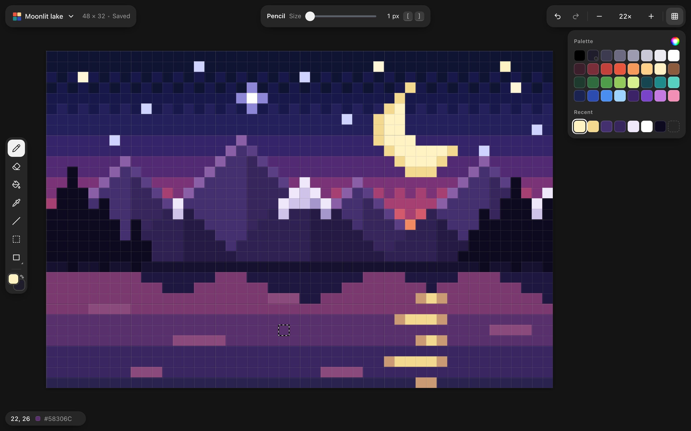

# 🖼️ Pixels

A small, fast bitmap editor for pixel art and marking up screenshots. It opens images exactly as your other apps show them, keeps every pixel crisp at any zoom, and stays out of the way while you draw.

Pixels runs in your browser on desktop and phone. There's nothing to install and no account to create, and your work saves as you go.

> _Try it out:_ [web playground](https://lostintangent.github.io/pixels)

## Features

- **True color:** Mac screenshots and other Display P3 images look exactly like they do in Preview, and exports keep their color.
- **Crisp pixels:** Zoom settles on whole device pixels, so art stays square and sharp on every display.
- **Editable markup:** Add rectangles and arrows from the Shapes menu, then move, resize, and restyle them anytime.
- **Fast:** Drawing, filling, and panning stay smooth even on big screenshots, held to strict performance budgets.
- **Desktop and phone:** Draw with a mouse, pen, or finger, and pinch to zoom, in a layout made for each.
- **Always saved:** Every change saves in the browser, so a reload never loses work.
- **Keyboard friendly:** Shortcuts work across keyboard layouts, and `?` lists them all.

## Developing

1. Clone this repo and install [Bun](https://bun.sh) 1.4.3 or newer
1. `bun install`
1. `bun run dev`

See [AGENTS.md](AGENTS.md) for tests, performance gates, and how the code is organized.
